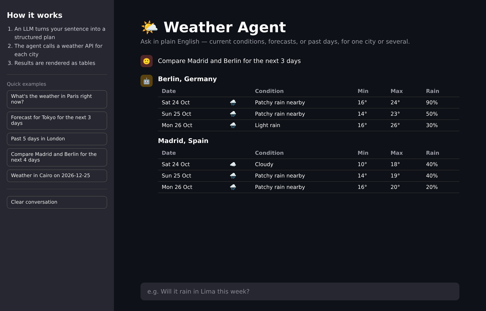
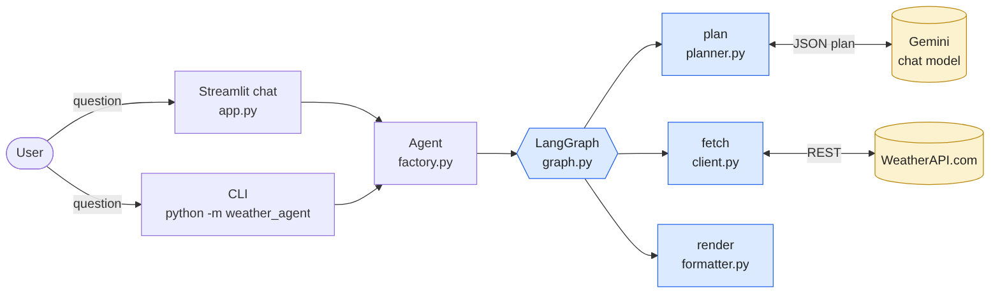
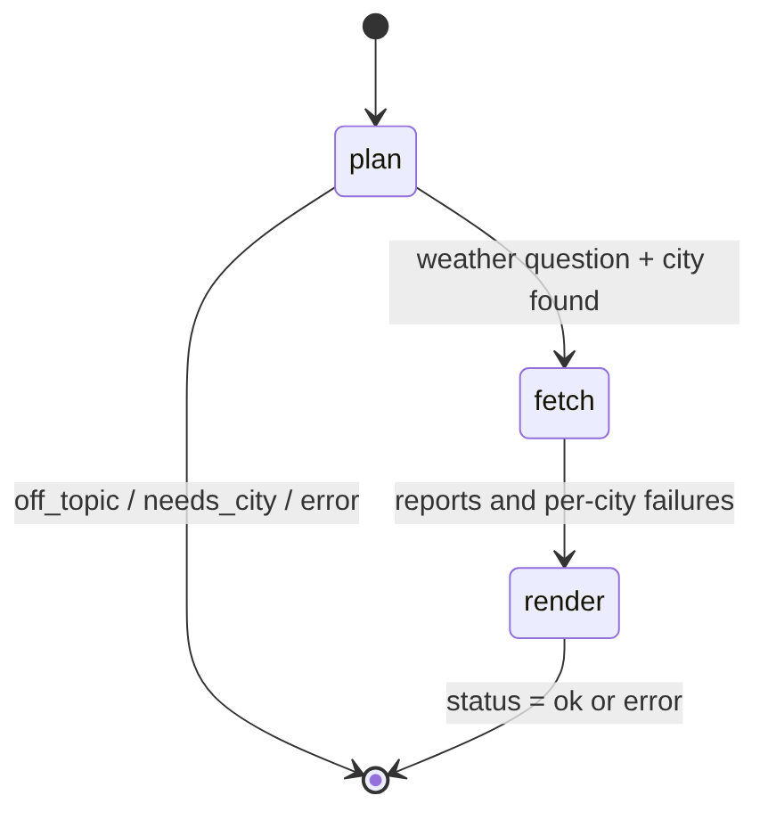
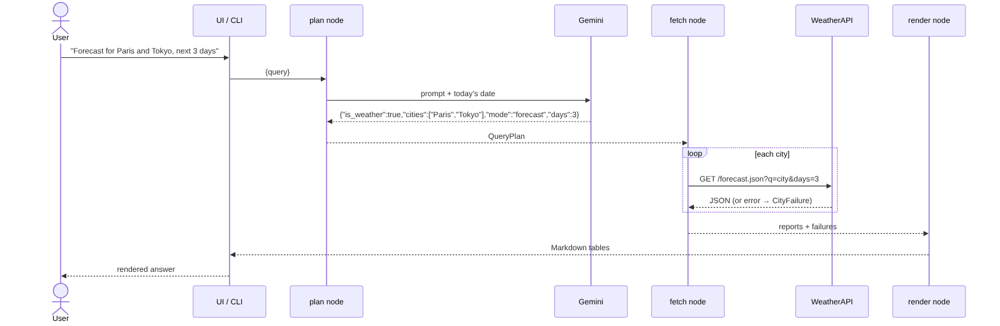
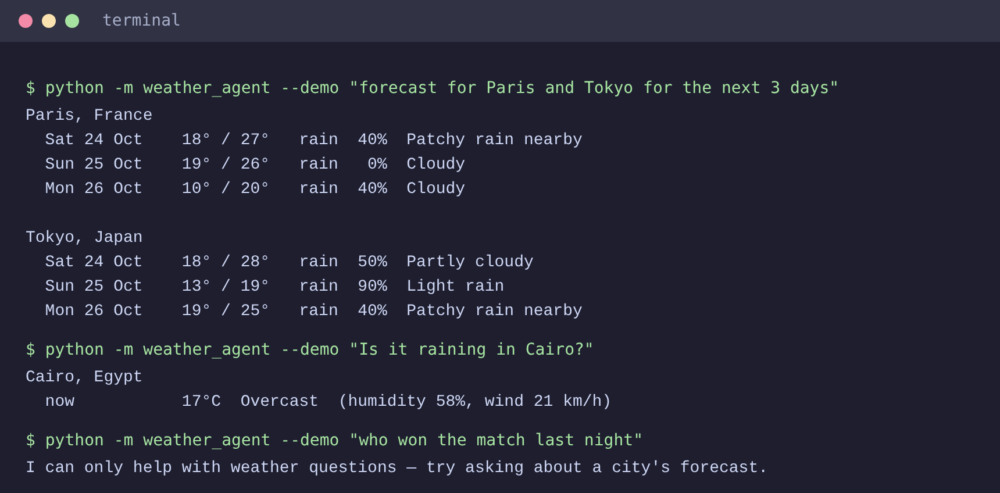

# SkyQuery-Weather Agent

Ask about the weather in plain English and get clean tables back. An LLM turns your sentence into a structured plan, a LangGraph state machine fetches the data from a weather API, and the results are rendered in a chat UI or in the terminal



## What it can do

| Ask for… | Example | Data source |
|---|---|---|
| Current conditions | `Is it raining in Cairo?` | `current.json` |
| Multi-day forecast | `Forecast for Tokyo for the next 3 days` | `forecast.json` |
| Past days | `Past 5 days in London` | `history.json` |
| One specific date | `Weather in Cairo on 2026-12-25` | history or forecast, chosen automatically |
| Several cities at once | `Compare Madrid and Berlin for the next 4 days` | one call per city |

Off-topic questions are politely refused, a missing city triggers a follow-up prompt, and one bad city name never breaks the rest of the answer

## How it works



The agent is a small LangGraph with three nodes. Routing after `plan` decides whether there is anything to fetch



A full request, end to end:



The language model only has one job: return JSON describing *what* was asked. All date arithmetic, clamping and validation happens in ordinary Python (`planner.py`), which keeps the behaviour testable

## Quick start

```bash
git clone <your-repo-url> weather-agent
cd weather-agent

python3 -m venv .venv
source .venv/bin/activate          # Windows: .venv\Scripts\activate
pip install -r requirements.txt
```

**Try it with no keys at all** (synthetic data, offline):

```bash
python -m weather_agent --demo "forecast for Paris and Tokyo for the next 3 days"
```

**Use live services:**

```bash
cp .env.example .env               # then edit .env with your own keys
streamlit run app.py
```

You need a Google AI Studio key (for the Gemini model) and a WeatherAPI.com key

## Usage

### Web chat

```bash
streamlit run app.py
```

Type a question, or click an example in the sidebar. Set `WEATHER_AGENT_DEMO=1` to run the same UI on sample data

### Command line

```bash
python -m weather_agent "past 3 days in London"
python -m weather_agent --demo "Is it raining in Cairo?"
```



Exit codes: `0` success, `1` no answer (off-topic, no city, all lookups failed), `2` configuration error

### Python

```python
from weather_agent import build_agent, Settings

agent = build_agent(Settings.from_env(demo=True))
state = agent.ask("Forecast for Oslo for the next 2 days")
print(state["status"], len(state["reports"]))
```

### Notebook

`notebooks/walkthrough.ipynb` runs each stage separately (plan → fetch → render) and starts in demo mode

## Project layout

```
weather-agent/
├── app.py                    # Streamlit chat interface
├── weather_agent/
│   ├── __main__.py           # CLI entry point
│   ├── config.py             # Settings from environment / .env
│   ├── models.py             # QueryPlan, DayReport, CityFailure
│   ├── planner.py            # LLM prompt + JSON validation + date logic
│   ├── client.py             # WeatherAPI.com client
│   ├── pipeline.py           # plan / fetch / render stages
│   ├── graph.py              # LangGraph wiring
│   ├── formatter.py          # Markdown and plain-text output
│   ├── factory.py            # build_agent(): picks live or demo backends
│   └── demo.py               # offline fake LLM + sample data
├── tests/test_agent.py
├── notebooks/walkthrough.ipynb
├── docs/{images,diagrams}/   # PNGs and their Mermaid sources
├── requirements.txt
└── .env.example
```

## Configuration

| Variable | Required | Purpose |
|---|---|---|
| `GOOGLE_API_KEY` | live mode | Gemini access |
| `WEATHER_API_KEY` | live mode | WeatherAPI.com access |
| `WEATHER_AGENT_MODEL` | no | Model name (default `gemini-2.5-flash`) |
| `WEATHER_AGENT_DEMO` | no | `1` = offline demo mode |

Keys are read from the environment or a local `.env` file, which is git-ignored. Never hard-code keys in source or notebooks

## Testing

```bash
pip install -r requirements-dev.txt
pytest
```

The suite uses a fake LLM and a fake HTTP session, so it needs neither network nor keys. It covers JSON parsing edge cases, date fallbacks, partial city failures, API error handling and output formatting

## Design notes

- **Structured plan, one model call.** One JSON response replaces several free-text prompts, so there is less latency and nothing to string-split
- **No hidden defaults.** If no city is given, the agent asks instead of silently picking one
- **Real "current" data.** Current conditions come from the live endpoint, not from today's daily history entry
- **Failures are data.** Per-city errors are collected and shown next to the successful results
- **Plan limits.** Forecast and history ranges are clamped to 14 days; your WeatherAPI plan may allow less
